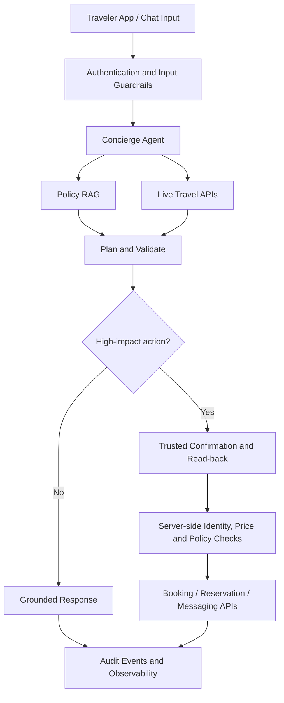

# Airbnb AI Trip Concierge — Agentic AI System Design

**Project author:** Mahesh Zade  
**Project completion date:** 13 October 2026  
**Guidance:** Amit Harjani, Microsoft  
**Project type:** PM / TPM Agentic AI System Design

## 1. Project overview

The Airbnb AI Trip Concierge is a proposed agentic system that helps travelers discover and manage stays through a conversational interface. The assignment scenario covers destination research, listing discovery, live price and availability, booking, cancellations, date changes, refund-policy answers, host messaging, and in-stay support.

The design starts from **blast radius**: recommendations can tolerate some uncertainty, but payments, cancellations, reservation changes, and personal-data disclosure require stronger controls.

## 2. Goals

- Help travelers discover and manage stays end to end.
- Give live price and availability information from travel APIs.
- Ground policy answers in authoritative, versioned policy content.
- Protect traveler and host information through identity and entitlement checks.
- Require trusted confirmation for irreversible or high-impact actions.
- Measure decision quality and safety, not only service uptime.

## 3. Architecture



### Main components

- **Concierge agent:** Interprets the traveler’s request and coordinates approved tools.
- **Policy RAG:** Retrieves relevant policy clauses and returns source/effective-date context.
- **Live travel APIs:** Retrieve current listings, prices, availability, and reservation state.
- **Guardrails and validators:** Enforce identity, region, schema, policy, and action constraints.
- **Trusted confirmation UI:** Shows the user exactly what will happen before a high-impact action.
- **Audit and observability:** Records decisions and tool outcomes for quality, security, and incident review.

## 4. Knowledge strategy: RAG versus live tools

| Information | Preferred source | Reason |
|---|---|---|
| Cancellation and refund policy | Versioned, clause-level RAG | Stable reference content that must be cited |
| Host house rules | Listing-specific RAG, refreshed on edits | Citable and tied to a listing |
| Destination guides | Batch-refreshed knowledge base | Slow-changing narrative content |
| Price and availability | Live API | Perishable state; do not trust a stale index |
| Traveler trip history | Authenticated live API | Personal and session-specific state |

### Retrieval pipeline

1. Authenticate the traveler and determine applicable region and entitlements.
2. Apply entitlement filters **before** retrieval.
3. Search using lexical and semantic retrieval.
4. Merge and rerank the authorized results.
5. Ground the response in the retrieved source and version.
6. Cite the relevant clause or abstain when evidence is insufficient.

## 5. Tools and permissions

| Action | Class | Default control |
|---|---|---|
| Search listings and destination guidance | Read | May auto-execute |
| Check current price and availability | Read | Live API; validate freshness |
| Read the traveler’s own reservation | Read | Authenticated, user-scoped access |
| Draft a host message | Write / staged action | Show draft to traveler |
| Hold inventory or stage a change | Write | Validate expiry and state |
| Book, pay, cancel, or commit a change | Trigger | Trusted confirmation and read-back |
| Send a host message | Trigger | Confirm recipient and exact message |

The model’s tool schema helps constrain requests, but **server-side validation is authoritative**. Re-check identity, permissions, inventory, price, policy, and idempotency at execution time.

## 6. Example workflow: changing a Lisbon stay

1. Authenticate the traveler and retrieve only their reservation.
2. Resolve the requested dates; clarify if “next weekend” is ambiguous.
3. Check current availability and price delta using a live API.
4. Retrieve the applicable change/cancellation policy.
5. Draft the proposed change and host message.
6. Read back the dates, amount, policy impact, recipient, and message.
7. Obtain explicit confirmation in trusted UI.
8. Revalidate on the server and commit the action once.
9. Return the result and confirmation details; record an audit event.

## 7. Security and failure handling

- Treat listing descriptions, reviews, and host messages as untrusted data.
- Do not allow retrieved text to authorize a tool call.
- Apply user/region entitlements before retrieval and server-side authorization before action.
- Use least-privilege tool permissions and constrained schemas.
- Use idempotency keys for booking or other trigger operations.
- Do not blindly retry financial or irreversible triggers.
- Refresh expired quotes and seek confirmation again if the terms change.
- Stop and explain when sources disagree, authorization fails, or policy retrieval is insufficient.

## 8. Observability and evaluation

Track decision-level measures as well as service health:

- Booking and reservation-change correctness
- Quote freshness and price mismatch rate
- Policy citation correctness and abstention quality
- Unauthorized action and personal-data leakage incidents
- Prompt-injection resistance
- Duplicate-trigger and idempotency conflicts
- Task completion, support handoff, tool errors, and latency

Suggested evaluation sets should include routine, ambiguous, adversarial, boundary, and tool-failure scenarios. Any proposed numerical thresholds are hypotheses to calibrate with measured data, not universal guarantees.

## 9. Trade-offs

- Confirmation adds friction and latency, but reduces unintended commitments.
- Live reads cost more than cached answers, but reduce stale-price and availability errors.
- Citation requirements reduce unsupported policy claims, at the cost of abstaining on weak evidence.
- A single agent is the starting point; add specialist agents only if measured context overload, competing objectives, or a genuine specialization need justifies them.

## 10. Prototype status and production gap

The supplied Langflow JSON describes a flow with Chat Input, Prompt Template, an OpenAI model, Policy RAG Tool, Travel API Tool, Concierge Agent, and Chat Output. The sample custom tools return illustrative static values. Treat this as an orchestration prototype—not as a live booking integration.

Before production, add authenticated real APIs, validated retrieval, secure secret management, authorization, idempotency, monitoring, evaluation, incident runbooks, and controlled rollout.

## 11. Suggested repository structure

```text
airbnb-ai-trip-concierge/
├── README.md
├── flows/
│   └── airbnb_concierge_flow.json
├── diagrams/
│   └── architecture.mmd
├── docs/
│   ├── requirements.md
│   ├── threat-model.md
│   └── evaluation-plan.md
└── tests/
    ├── routine-cases.md
    ├── adversarial-cases.md
    └── failure-cases.md
```

## 12. Disclaimer

This repository documents a system design and prototype flow. It does not claim affiliation with, endorsement by, or deployment within Airbnb. Production implementation requires real API integrations, security review, legal/policy validation, and operational testing.
