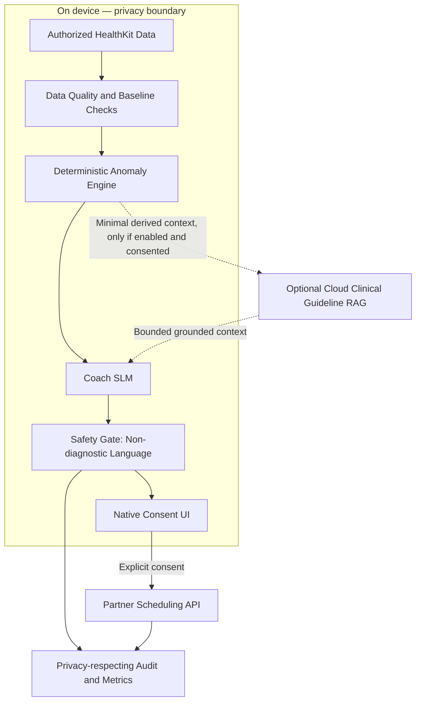

# Apple Health AI Coach — Agentic AI System Design

**Project author:** Mahesh Zade  
**Project completion date:** 13 October 2026  
**Guidance:** Amit Harjani, Microsoft  
**Project type:** PM / TPM Agentic AI System Design

## 1. Project overview

The Apple Health AI Coach is a proposed privacy-preserving coaching assistant that summarizes personal health metrics, explains trends, and helps users consider appropriate next steps.

The design keeps **raw health data on the device by default**, uses deterministic logic for baseline/anomaly analysis, and limits the language model to explaining results within safety boundaries. It is not designed to diagnose conditions or prescribe treatment.

## 2. Goals and safety principles

- Summarize authorized personal metrics and trends.
- Use deterministic, validated logic for anomaly detection rather than relying on an LLM as the detector of record.
- Explain findings in clear, calibrated, non-diagnostic language.
- Keep raw HealthKit data on device by default.
- Send only minimum-necessary derived context to a cloud service, if enabled and consented.
- Require explicit consent before external actions such as scheduling.
- Stop, abstain, or route appropriately when evidence is weak or a potentially urgent situation is detected.

## 3. Architecture



### Main components

- **On-device data access:** Reads only authorized health data.
- **Data quality and baseline checks:** Account for missing readings, sensor quality, and personal baseline.
- **Deterministic anomaly engine:** Produces validated findings or routes events according to approved rules.
- **Coach model:** Explains trends and uncertainty; it is not the diagnostic engine.
- **Safety gate:** Blocks or routes unsafe, diagnostic, prescriptive, or falsely reassuring responses.
- **Optional guideline retrieval:** Retrieves approved, versioned guidance when cloud use is enabled and consented.
- **Native consent UI:** Requires explicit user approval before external actions.
- **Privacy-respecting audit:** Collects only the evidence necessary for quality, safety, and incident response.

## 4. Knowledge strategy

- Use authoritative, versioned clinical or public-health guidance for general explanations.
- Preserve source provenance and effective dates.
- Use on-device personal history for an individual’s baseline and trends.
- Do not treat general guidance as a diagnosis of an individual.
- If evidence is unavailable, conflicting, or insufficient, abstain and encourage consultation with an appropriate qualified professional.

## 5. Deterministic analysis and model boundaries

The deterministic engine should handle the detection logic for the selected metric/device and be validated for its intended use. The LLM explains the resulting observation and uncertainty; it must not independently invent a threshold or present a trend as a diagnosis.

Important considerations include:

- Sensor noise and device differences
- Missing or incomplete measurements
- Baseline drift and changes in measurement patterns
- False positives and false negatives
- Clinically reviewed escalation rules for potentially urgent cases

Clinical thresholds and safety behavior require appropriate validation and oversight before real-world use.

## 6. Tools and permissions

| Action | Class | Default control |
|---|---|---|
| Summarize authorized health metrics | Read | Local, scoped access |
| Explain trends and uncertainty | Response | Safety-gated and grounded |
| Save an approved goal or reminder | Write | User approval as required by product policy |
| Schedule an appointment or contact a partner | Trigger | Explicit consent in native UI |

Use minimum-necessary data and purpose limitation for all external calls. Never infer that derived data is automatically anonymous; evaluate re-identification risk.

## 7. Example user journey

Example question: “Why was my resting heart rate higher this week?”

1. Read authorized metrics locally and check completeness.
2. Compare the observations with the user’s baseline using validated deterministic logic.
3. Provide the coach model with the derived result and relevant uncertainty.
4. Generate a clear explanation without diagnosis or prescription.
5. Run the response through the safety gate.
6. If an external action is offered, request explicit approval in the native UI.
7. Return a bounded explanation and appropriate next steps.

## 8. Privacy and security

- Keep raw HealthKit data on device by default.
- Make cloud processing optional and consent-based.
- Send only minimum-necessary derived context when required.
- Protect data in transit and at rest.
- Enforce scoped access, retention limits, deletion paths, and appropriate audit controls.
- Keep secrets out of flow exports and source control.
- Review data flows for accidental disclosure through logs, prompts, analytics, and error traces.

## 9. Observability and evaluation

Measure safety, quality, and operations separately.

**Safety**
- False-negative and false-reassurance investigations
- Unsafe or diagnostic/prescriptive responses
- Privacy-boundary violations
- Consent violations and unsafe external actions

**Quality**
- Faithfulness to deterministic findings
- Groundedness in approved guidance
- Calibration of uncertainty
- User comprehension and usefulness

**Operations**
- On-device latency and availability
- Cloud timeout/fallback rate
- Data completeness and sensor-quality issues
- Battery and resource impact

Evaluation should cover routine, ambiguous, adversarial, missing-data, urgent-routing, and cloud-failure cases. Clinical performance claims require validated evidence.

## 10. Failure handling and trade-offs

- If data is missing or low quality, say so rather than overstate a trend.
- If guidance is conflicting or retrieval fails, abstain from unsupported claims.
- If the cloud is unavailable, retain safe on-device functions where possible.
- Critical routing must not depend solely on generative model output.
- Privacy-first local processing may limit some cloud capabilities, but reduces data exposure.
- Explicit consent adds friction but protects user agency.
- Safety coverage may be narrower than a general-purpose health chatbot, by design.

## 11. Prototype status and production gap

The supplied Langflow screenshot/flow shows Chat Input connected to a Tool Calling Agent with Health Vitals Tool and Clinical Scheduler Tool, a language model, and Chat Output. This demonstrates the intended tool-orchestration shape.

It does not by itself prove HealthKit integration, on-device privacy enforcement, clinically validated anomaly detection, or production appointment scheduling. Those controls must be implemented and tested separately.

## 12. Suggested repository structure

```text
apple-health-ai-coach/
├── README.md
├── flows/
│   └── Apple Health AI Coach.json
├── diagrams/
│   └── architecture.mmd
├── docs/
│   ├── privacy-boundary.md
│   ├── safety-policy.md
│   ├── clinical-validation-plan.md
│   └── evaluation-plan.md
└── tests/
    ├── routine-cases.md
    ├── missing-data-cases.md
    └── safety-and-escalation-cases.md
```

## 13. Disclaimer

This is a system-design and prototype project, not a medical device or clinical service. It is not a substitute for professional medical advice, diagnosis, or treatment. Clinical deployment requires qualified clinical governance, validated thresholds and models, privacy/security review, regulatory assessment where applicable, and operational safety monitoring. No affiliation with or endorsement by Apple is implied.
